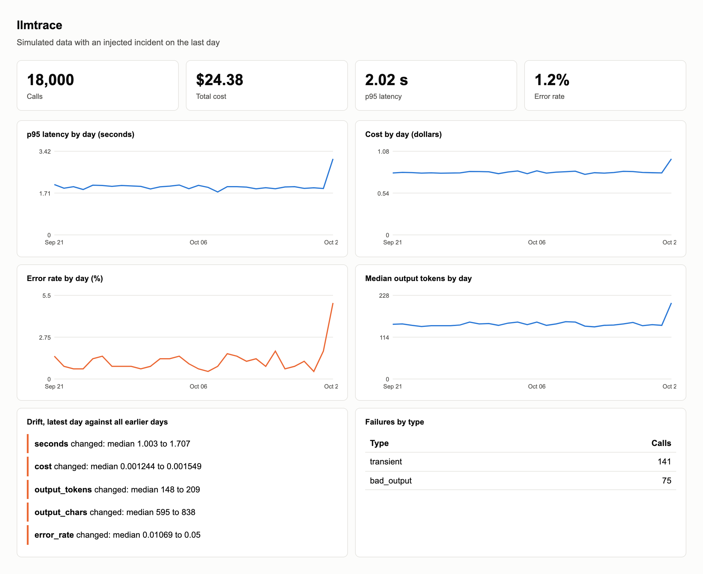
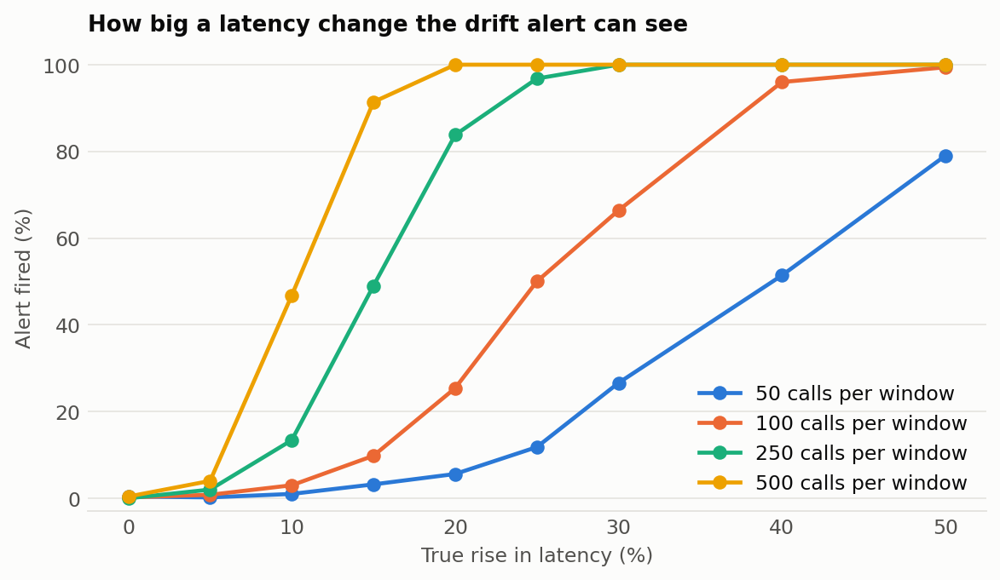

# llmtrace

Local first observability for LLM apps. It records every model call to one SQLite file, reports cost and failures, and tells you when behavior has shifted, with no server, account or dependencies.

```python
from llmtrace import Tracer

tracer = Tracer("traces.db", prices={"my-model": (1.00, 5.00)})   # dollars per million tokens

with tracer.span("answer_question"):
    with tracer.llm("generate", "my-model") as span:
        reply = client.complete(prompt)
        span.record(input_tokens=reply.input, output_tokens=reply.output, output=reply.text)
```

```
llmtrace report traces.db
llmtrace drift traces.db --hours 24    # exits 1 on drift, so cron or CI can alert
```

## Dashboard

`llmtrace dashboard traces.db --out dashboard.html` writes one offline HTML file. Hover a point for its value.

<picture>
<source media="(prefers-color-scheme: dark)" srcset="results/charts/dashboard-dark.png" />

</picture>

*Simulated month with an injected incident on the last day, so the alerts are expected.*

## How good is the drift detector?

<picture>
<source media="(prefers-color-scheme: dark)" srcset="results/charts/power-dark.png" />

</picture>

[`benchmarks/evaluate.py`](benchmarks/evaluate.py) simulates 500 trials per scenario with known changes, comparing a baseline window against a current one. The table shows how often an alert fired:

| True change | 100 calls per window | 500 calls per window |
| :--- | ---: | ---: |
| None (false alarm rate) | 0.6% | 0.0% |
| Latency +10% | 3.8% | 45.2% |
| Latency +25% | 48.4% | 100% |
| Latency +50% | 100% | 100% |
| Output length +25% | 25.8% | 100% |
| Output length +50% | 93.2% | 100% |
| Errors 1% to 3% | 0.6% | 12.4% |
| Errors 1% to 6% | 0.8% | 89.8% |

**What that means in practice:** false alarms are rare, because the thresholds are deliberately strict for a check that runs repeatedly. The cost is sensitivity at low volume. At 100 calls per window, even errors going from 1% to 6% almost never fire, so a small app shouldn't rely on the error alert. You need about 500 calls per window for it to be useful.

These are simulated log normal streams, not production traffic. Real traffic has daily cycles and shifts in user mix that would raise the false alarm rate, so compare like for like windows.

## What it records

* **Nested spans.** Parent and trace ids flow through `contextvars`, so threads don't mix, and async tasks should behave the same way, though only threads are tested.
* **Cost** from your own price table, so it can't go stale silently. Unknown models record $0 rather than a guess.
* **Failures grouped by what you'd do about them:** transient, auth, bad output, too long, and other.

Adding a span costs about 10 microseconds on the calling thread, because writes are batched on a background thread and enqueue only. Spans still in memory are lost if the process is killed, though a normal exit flushes them.

## Limitations

* **Prompts and outputs aren't stored**, only output length, which is a privacy choice. It can see that answers got longer, not that they got worse.
* **It detects change, not quality.** Pair it with an eval suite such as [promptgate](https://github.com/Mukund604/promptgate).
* **Single machine and manual instrumentation.** For a team or auto instrumentation, use [Langfuse](https://langfuse.com) or OpenTelemetry.
* **Not yet run on a live application.**

## Run it

```
pip install -e ".[dev]"
pytest
python -m benchmarks.evaluate    # needs matplotlib
```
